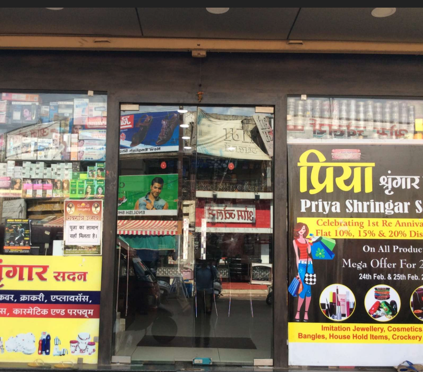
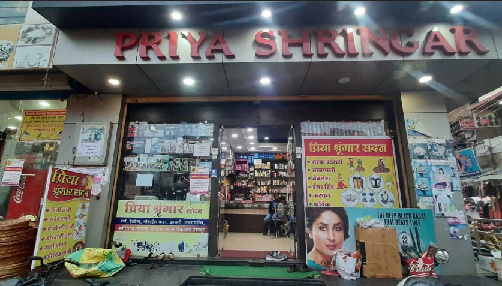

# Field guide: what to do at Priya Shringar Kendra (delete before submitting)

## Before you start
- Ask the owner first: "I'm a student doing a college project. Can I sit here for an hour and note down what customers ask for? I won't take any names." Note the owner's **name** and their role (owner, son, helper).
- Take **photo 1**: the shop front with a clock or your phone's time visible.
- 

## Logging (aim for 60–90 min, 25+ rows)
For every customer request, write one line in a notebook immediately:

| column | what to write |
|---|---|
| date | 2026-11-20 |
| time | the exact time, e.g. 16:07 (not 16:00) |
| item | what they asked for, in their own words: "black bindi", "size 2.6 kaanch chudi", "lakme kajal" |
| category | bindi / bangle / jewellery / cosmetic / hair / accessories / stationery / other |
| in_stock | y or n: did the shop have it? |
| bought | y or n |
| price_rs | the price the owner quoted. **Leave blank if nobody said it** (gaps are fine; they're honest) |
| customer_type | student / local / other, your best guess |
| note | anything odd: "asked for different shade", "said she'll check the Jhalwa market" |

- Take **photo 2** halfway through: your notebook page with the shelf behind it.
- Type the notebook into `data.csv` the same evening and **keep the notebook** in case the panel asks about a row.

## Conversation with the owner (in a quiet moment, ~5 min)
1. When something runs out, how do you find out?
2. How do you decide what to buy? Who's the supplier, and how often do you go?
3. What do IIIT students ask for that you don't keep?
4. Has a customer ever left because you didn't have something? What was it?
5. What time of day is busiest? Does it change around exams, festivals or the wedding season?

Write down 3 things they said **in their own words**, plus the 1 thing that surprised you. That's what the panel scores.

## Then
- Run `python reorder.py` and **show the owner the output**. What they say about it is good material for reflection.md.
