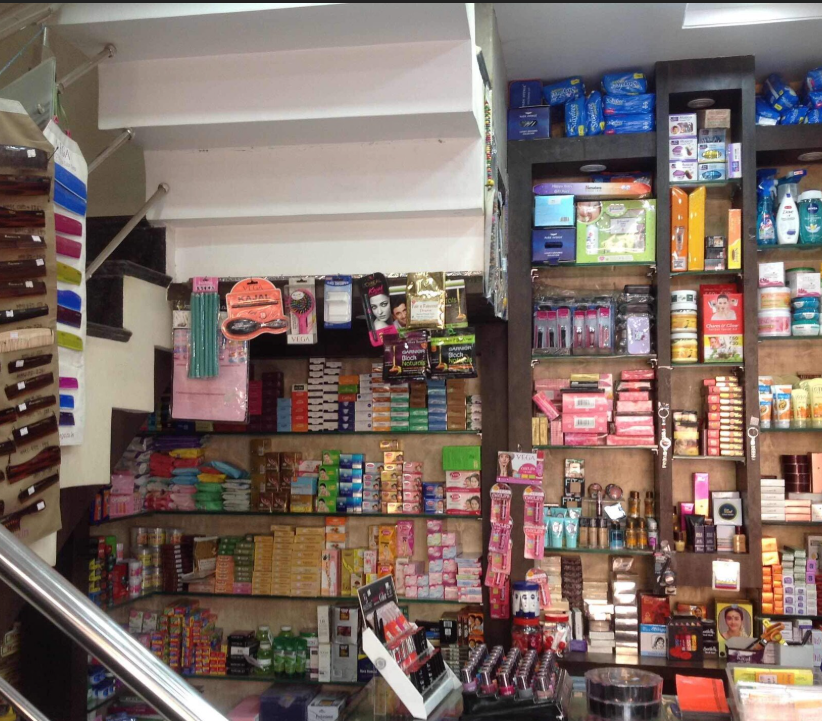
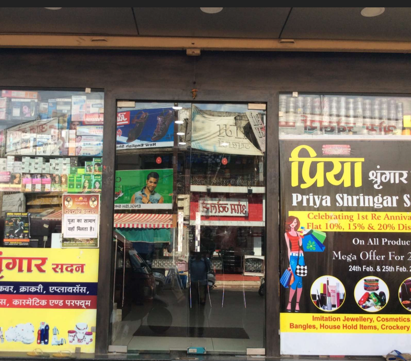
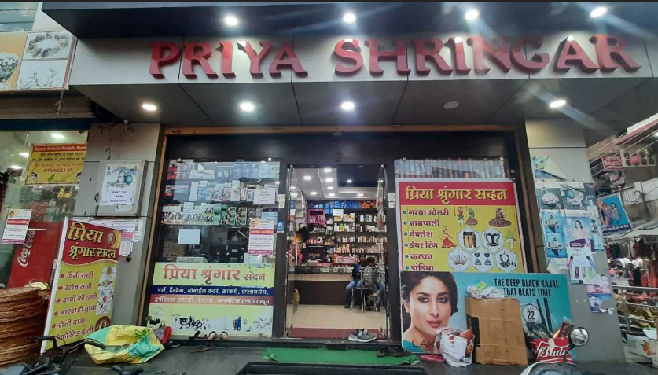

# Fieldwork

**Place:** Priya Shringar Sadan, 4, IIIT Rd, Jhalwa, Prayagraj 211015
**Date / time on site:** 2026-11-__, __:__ to __:__

## Photos
- `photos/img06.png`: shopfront signboard, taken at __:__
- `photos/img01.png` to `img05.png`: inside the shop, taken at __:__

## Conversation
- **Name / role:** ___
- **3 things they said:**
  1. "___"
  2. "___"
  3. "___"
- **1 thing that surprised me:** ___

## How the data was collected
I sat at ___ from __:__ to __:__ and wrote one line per customer request in a notebook.
Then I typed it into `data.csv` on ___. Prices are left blank where the owner didn't say one.
`in_stock` means ___. Things I couldn't capture: ___

## Challenges during fieldwork
During my fieldwork, I identified some challenges related to collecting customer demand and inventory information from a small retail shop.

- Most inventory information was maintained manually.
- There was no structured record of products customers requested but could not purchase.
- Different names were used for the same products, which could create duplicate entries in the dataset.
- The shop owner's availability was limited because of regular customer interactions.
- Understanding actual demand was difficult because sales records alone did not capture missed purchases.

## How I addressed these challenges
I used a structured data format containing date, time, item, category, stock availability, purchase status, price, customer type, and notes.
I also planned to introduce an alias mapping system to standardize different names for the same product.

## What I learned
I realized that inventory management is not just about tracking what sells. It is also important to understand what customers want but cannot find. Recording missed demand can help make reorder recommendations more useful.
